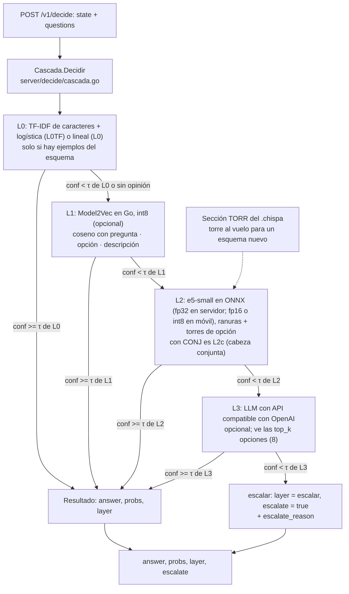
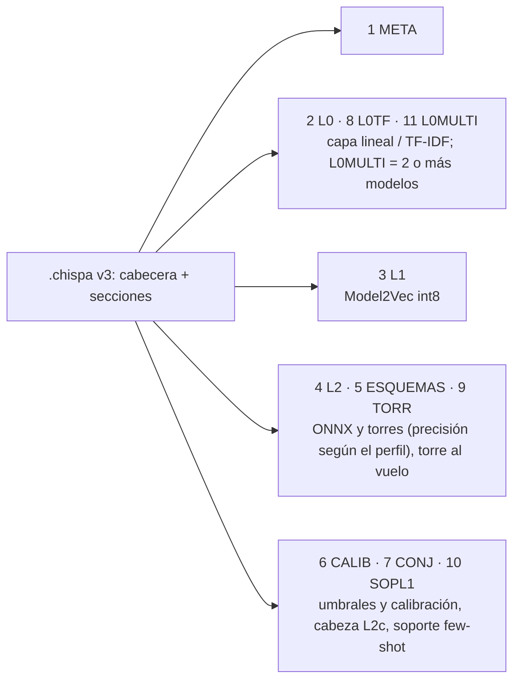
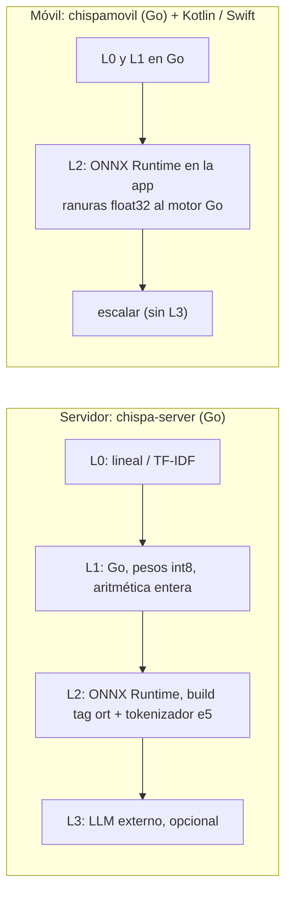

<p align="center">
  
</p>

<h1 align="center">Chispa</h1>

<p align="center">
  <strong>Servidor de clasificación tipada y open source: un texto, una pregunta con opciones (choice, sí/no o score) y una respuesta con su probabilidad.</strong>
</p>

<p align="center">
  <a href="LICENSE"></a>
  
</p>

<p align="center">
  <a href="#los-dos-modos">Modos</a> ·
  <a href="#cómo-arrancarlo">Arrancar</a> ·
  <a href="#cifras-honestas">Cifras</a> ·
  <a href="#qué-está-refutado">Refutado</a> ·
  <a href="#modo-clásico-congelado">Modo clásico</a> ·
  <a href="docs/00-indice.md">Documentación</a>
</p>

---

## Qué es Chispa hoy

Chispa es un servidor de clasificación tipada: mandas un texto y una pregunta cerrada con sus opciones (`choice`, sí/no o `score`) y
recibes la opción elegida y una probabilidad por opción, con un LLM pequeño (Qwen3-4B por logprobs) o con un kNN sobre tus ejemplos.

> [!IMPORTANT]
> **Qué es y qué no.** Mejora de verdad sobre un baseline cuando le das ejemplos y usas el modo GPU: **0,501** de macro de exactitud en
> 8 tareas selladas, frente a 0,451 del mismo LLM sin ejemplos y 0,128 de la clase mayoritaria. Esa mejora sobre el LLM sin ejemplos
> (+5,1) **no es estadísticamente firme** (IC95 por tareas [−4,3, +15,5]) y `score` es experimental. Detalle en [Cifras honestas](#cifras-honestas).

## Los dos modos

| | **Modo GPU** | **Modo CPU** |
|---|---|---|
| Qué hace | Todo va a L3: Qwen3-4B-Instruct-2507 por logprobs con 8 demostraciones (fs8) elegidas por kNN. En `score`, rúbrica y umbrales calibrados. El kNN solo sirve para elegir demos y el top-k; el escalado está apagado | Solo kNN sobre tus ejemplos. Sin LLM |
| Cuándo | Quieres la mayor exactitud y tienes una GPU (las cifras son de una A10G) | No hay GPU, o la latencia y el coste mandan sobre la exactitud |
| Requisitos | GPU con vLLM; ejemplos por clase (8 por clase para fs8); en `score`, una rúbrica por nivel escrita por ti | Ejemplos por clase (8 por clase en la medida): en la petición o en bancos. Sin ejemplos no contesta |
| Codificador | e5-small para elegir demos | e5-small (por defecto) o Qwen3-Embedding-0.6B (opcional) |
| Latencia orientativa | L3 p50 ≈ 0,6 s con 8 clientes y filas de 60 opciones; p95 ≈ 4 s ([`LEEME` §17.5](model/alt/resultados-20261113-p0-p2/LEEME.md#175-resultado-de-r10-caudal-ec2-inst-33-g5-2026-11-16--045-usd)) | kNN ≈ 1 ms y codificador e5 ≈ 8,6 ms en serie ([`PRODUCTO.md`](server/PRODUCTO.md), R10); con Qwen3-Embedding el kNN es 0,07 ms, pero el codificador da p50 ≈ 1 s en CPU (c7i.xlarge, 4 hilos) ([§19.3](model/alt/resultados-20261113-p0-p2/LEEME.md#193-segunda-corrida-ec2-inst-15-c7ixlarge-us-east-1f-launchtime-074430-utc--listo-092043-verificado-0921--97-min--029-usd-ud-ud-l2-qwen3emb-5d9e86csh-l2-qwen3emb-5d9e86cjson-pasa-pasa_todotrue)) |
| Coste orientativo | g5.xlarge bajo demanda ≈ 1,006 USD/h ([§12.5](model/alt/resultados-20261113-p0-p2/LEEME.md#125-resultado-ec2-inst-08-2026-11-13-incompleto-falta-el-q4-sin-q4-no-pasaría-agrupada-06497-frente-a-065)); caudal de 7,5 a 10 peticiones/s por g5 con filas de 60 opciones, limitado por vLLM ([§17.5](model/alt/resultados-20261113-p0-p2/LEEME.md#175-resultado-de-r10-caudal-ec2-inst-33-g5-2026-11-16--045-usd)) | c7i.xlarge ≈ 0,1785 USD/h ([§19.3](model/alt/resultados-20261113-p0-p2/LEEME.md#193-segunda-corrida-ec2-inst-15-c7ixlarge-us-east-1f-launchtime-074430-utc--listo-092043-verificado-0921--97-min--029-usd-ud-ud-l2-qwen3emb-5d9e86csh-l2-qwen3emb-5d9e86cjson-pasa-pasa_todotrue)) |

Sobre el codificador del modo CPU: **Qwen3-Embedding-0.6B es «recomendado con GPU o cuando la latencia no importe»**. En CPU da p50 ≈ 1 s
por consulta y 2,2 GB de RAM, y a cambio +2,6 puntos de macro sobre e5 con 8 vecinos en dev (0,4683 frente a 0,4429, [§18.2](model/alt/resultados-20261113-p0-p2/LEEME.md#182-resultado-de-r11-ec2-inst-21-g5-us-east-1b-042857---0453-utc--24-min--04-usd-verificado-r11-alternativas-ba463e8json)).
El int8 no es viable (coseno 0,980 < 0,99, [§19.3](model/alt/resultados-20261113-p0-p2/LEEME.md#193-segunda-corrida-ec2-inst-15-c7ixlarge-us-east-1f-launchtime-074430-utc--listo-092043-verificado-0921--97-min--029-usd-ud-ud-l2-qwen3emb-5d9e86csh-l2-qwen3emb-5d9e86cjson-pasa-pasa_todotrue)).

Los tres tipos de pregunta, igual en los dos modos (contrato: [`server/api/openapi.yaml`](server/api/openapi.yaml)):

| `kind` | Qué pregunta es | Estado |
|---|---|---|
| `choice` | Elegir una opción | estable; hasta 62 opciones, y con más de 20, L3 ve solo el top-10 del kNN ([`PRODUCTO.md`](server/PRODUCTO.md)) |
| `noul` | Sí o no | estable |
| `score` | Nivel ordinal, ids `"1"` … `"K"` | **experimental** (`experimental: true`): solo ayuda con una rúbrica por nivel escrita por ti ([§17.21](model/alt/resultados-20261113-p0-p2/LEEME.md#1721-resultado-de-t3b-ec2-inst-36-g5--05-usd-verificado-t3b-cifras-91deb47json-pasa-con-rúbrica--umbrales-calibrados), [§17.26](model/alt/resultados-20261113-p0-p2/LEEME.md#1726-resultado-de-la-apertura-única-de-las-selladas-2-g5-a-inst-03-b-inst-18--21-usd-verificado-en-las-dos-apertura-selladas-29c441fjson-medido)) |

## Cómo arrancarlo

La guía está en [`server/PRODUCTO.md`](server/PRODUCTO.md): qué entra (ejemplos de oro, bancos), cómo generar los bancos, la config del servidor
(`server/deploy/config.ejemplo.json`, y `config.ejemplo-qwen3emb.json` para el codificador de Qwen), el contrato de respuesta, los límites y lo que queda pendiente.

Ya están en el servidor (ver `server/PRODUCTO.md`): ejemplos dentro de la petición HTTP (`examples[]`), la regla de `score` y las configuraciones
`server/deploy/config.modo-gpu.json` y `config.modo-cpu.json`.

```sh
cd server && go build -o chispa-server ./cmd/chispa-server   # con -tags ort para el codificador ONNX
```

## Cifras honestas

Todas las cifras son de exactitud (macro: media de las exactitudes por tarea) y salen de [`model/alt/resultados-20261113-p0-p2/LEEME.md`](model/alt/resultados-20261113-p0-p2/LEEME.md) o del fichero de resultados que se indica.

### Selladas: una sola apertura, 8 tareas

Se abrieron **una vez** (2026-11-16) con la configuración congelada de antemano; 4 tareas `choice` y 4 `score`; el sistema final y el 4B sin ejemplos cubren el 100 % de las 2 955 filas.
Fuente: [§17.26](model/alt/resultados-20261113-p0-p2/LEEME.md#1726-resultado-de-la-apertura-única-de-las-selladas-2-g5-a-inst-03-b-inst-18--21-usd-verificado-en-las-dos-apertura-selladas-29c441fjson-medido), `apertura-selladas-29c441f.json`. IC95 por tareas entre corchetes (solo 4 tareas por tipo, así que son anchos).

| sistema | choice | score | global (8) |
|---|---|---|---|
| mayoritaria del soporte | 0,108 | 0,149 | 0,128 |
| kNN-e5 (k = 8) | 0,483 [0,38, 0,60] | 0,320 [0,25, 0,42] | 0,402 |
| 4B sin ejemplos | 0,485 [0,31, 0,64] | 0,417 [0,36, 0,46] | 0,451 |
| **modo GPU (final)** | **0,614** [0,43, 0,77] | 0,389 [0,29, 0,48] | **0,501** |

Diferencias del final: frente al 4B sin ejemplos, +12,9 en `choice` [−1,6, +28,0], −2,7 en `score` [−12,4, +4,4] y +5,1 global [−4,3, +15,5];
frente a la mayoritaria, +37,3 global [+24,4, +50,9]; frente al kNN, +10,0 global [−0,0, +18,4]. **Lectura honesta:** en `choice`, el kNN (0,483) y el 4B sin ejemplos (0,485)
empatan; lo que sube es meter las demostraciones elegidas por kNN. En `score` el sistema final no mejora al 4B sin ejemplos.
Las selladas quedan gastadas: ya no son una medida ciega ([§17.26](model/alt/resultados-20261113-p0-p2/LEEME.md#1726-resultado-de-la-apertura-única-de-las-selladas-2-g5-a-inst-03-b-inst-18--21-usd-verificado-en-las-dos-apertura-selladas-29c441fjson-medido)).

### Dev: indicativas, 6 tareas

Las 6 tareas de desarrollo se miraron varias veces: son **indicativas** y confirmarlas exige una batería nueva sellada. Macro de exactitud
([§18.2](model/alt/resultados-20261113-p0-p2/LEEME.md#182-resultado-de-r11-ec2-inst-21-g5-us-east-1b-042857---0453-utc--24-min--04-usd-verificado-r11-alternativas-ba463e8json), `r11-alternativas-ba463e8.json`):

| sistema | macro dev (6) |
|---|---|
| 4B sin ejemplos | 0,478 |
| kNN Qwen3-Embedding-0.6B, 8 vecinos | 0,468 |
| kNN-e5, 8 vecinos | 0,443 |
| kNN-e5, 32 vecinos | 0,390 |

Con el servidor Go por HTTP, kNN con Qwen3-Embedding y 8 vecinos: **0,4700** (R11 en Python: 0,4683; cobertura 100 %,
[§19.3](model/alt/resultados-20261113-p0-p2/LEEME.md#193-segunda-corrida-ec2-inst-15-c7ixlarge-us-east-1f-launchtime-074430-utc--listo-092043-verificado-0921--97-min--029-usd-ud-ud-l2-qwen3emb-5d9e86csh-l2-qwen3emb-5d9e86cjson-pasa-pasa_todotrue)).
Otras cifras de dev: demostraciones elegidas por kNN frente a al azar, +5,5 de macro en 5 tareas ([§17.24](model/alt/resultados-20261113-p0-p2/LEEME.md#1724-resultado-de-d-ec2-inst-24-g5-54-min--10-usd-verificado-d-cifras-91deb47json-no-medido-por-cobertura-0902--1-informativo-demos-por-knn-55-la-mezcla-no-aporta));
en `score`, la rúbrica escrita más los umbrales calibrados sube +15,1 de exactitud macro sobre 3 tareas ([§17.21](model/alt/resultados-20261113-p0-p2/LEEME.md#1721-resultado-de-t3b-ec2-inst-36-g5--05-usd-verificado-t3b-cifras-91deb47json-pasa-con-rúbrica--umbrales-calibrados)),
pero con una rúbrica mecánica, en las selladas, resta 2,7.

## Qué está refutado

Cada línea es una hipótesis que se midió con criterio congelado y no se sostuvo. Sección de [`LEEME`](model/alt/resultados-20261113-p0-p2/LEEME.md) entre paréntesis.

- **Cross-encoder L2x entrenado:** queda por debajo del cruzado en 5 de 6 tareas ([§10](model/alt/resultados-20261113-p0-p2/LEEME.md#10-resultado-de-p3-l2x-refutado-2026-11-13)).
- **Fusión kNN-e5 + L2 y escalado por acuerdo:** refutada por el AUROC en hatecheck-es (0,616) ([§11.7](model/alt/resultados-20261113-p0-p2/LEEME.md#117-veredicto)).
- **Q4_K_M del 4B:** pierde 3,05 puntos y el criterio pedía ≤ 2 ([§12.7](model/alt/resultados-20261113-p0-p2/LEEME.md#127-resultado-de-la-ronda-de-q4-ec2-inst-13-2026-11-15-el-q4-pierde-305-puntos-y-no-cumple--2)).
- **LLM pequeños como L3 barato (Qwen3-1.7B y 0.6B):** refutados, también por logprobs ([§13.6](model/alt/resultados-20261113-p0-p2/LEEME.md#136-resultado-de-r2-ec2-inst-19-g5xlarge-2026-11-15-los-dos-refutados), [§14.5](model/alt/resultados-20261113-p0-p2/LEEME.md#145-resultado-de-r5-ec2-inst-01-g5xlarge-2026-11-15-pequeños-refutados-el-4b-por-logprobs-da-0729)).
- **Prequential (el fondo etiquetado por el LLM se acumula sobre la marcha):** refutado en R6 y sin pasar en R8b ([§14.8](model/alt/resultados-20261113-p0-p2/LEEME.md#148-resultados-de-r6-en-la-c7i-ec2-inst-34-2026-11-15-r4-no-pasa-r6-refutado-versiones-y-latencia), [§15.5](model/alt/resultados-20261113-p0-p2/LEEME.md#155-resultado-de-r8b-ec2-inst-11-c7i2xlarge-2026-11-16-prequential-no-pasa-la-cascada-alcanza-a-l3-escalando-el-30-)).
- **Fondo etiquetado por el LLM para el kNN (few-shot C):** refutado en dev; hunde las tareas `score` donde el LLM falla ([§17.8](model/alt/resultados-20261113-p0-p2/LEEME.md#178-c-few-shot-real-en-v2-dev-preparado-código-8e27680-rama-r10-c-fusionada), resultado dentro de la misma sección).
- **Destilación del 4B en el biencoder:** el piloto empeora −11,2 a −14,1 puntos frente a e5 puro y se para ([§17.15](model/alt/resultados-20261113-p0-p2/LEEME.md#1715-resultado-del-piloto-de-destilación-ec2-inst-29-g5-51-min-de-trabajo--095-usd-verificado-r10-piloto-3c1a7ca-para)).
- **Cascada kNN → L3 sin fondo etiquetado:** solo funciona con datos; con 8 por clase pierde 1,3 puntos escalando la mitad y el AUROC del margen es 0,608 ([§17.23](model/alt/resultados-20261113-p0-p2/LEEME.md#1723-resultado-de-e-i7-0-usd-e-cascada-sin-fondo-9030c9bjson-no-pasa--la-cascada-solo-funciona-con-datos)); el kNN de Qwen tampoco la arregla ([§18.2](model/alt/resultados-20261113-p0-p2/LEEME.md#182-resultado-de-r11-ec2-inst-21-g5-us-east-1b-042857---0453-utc--24-min--04-usd-verificado-r11-alternativas-ba463e8json)). Por eso el modo GPU lo manda todo a L3.
- **Reranker Qwen3-Reranker-0.6B como clasificador:** −10,9 frente al 4B y igual de lento ([§18.2](model/alt/resultados-20261113-p0-p2/LEEME.md#182-resultado-de-r11-ec2-inst-21-g5-us-east-1b-042857---0453-utc--24-min--04-usd-verificado-r11-alternativas-ba463e8json)).
- **Rúbrica mecánica para `score`:** no se sostiene fuera de dev (−2,7 en las selladas) ([§17.26](model/alt/resultados-20261113-p0-p2/LEEME.md#1726-resultado-de-la-apertura-única-de-las-selladas-2-g5-a-inst-03-b-inst-18--21-usd-verificado-en-las-dos-apertura-selladas-29c441fjson-medido)).
- **int8 del Qwen3-Embedding:** no viable, coseno 0,980 < 0,99 ([§19.3](model/alt/resultados-20261113-p0-p2/LEEME.md#193-segunda-corrida-ec2-inst-15-c7ixlarge-us-east-1f-launchtime-074430-utc--listo-092043-verificado-0921--97-min--029-usd-ud-ud-l2-qwen3emb-5d9e86csh-l2-qwen3emb-5d9e86cjson-pasa-pasa_todotrue)).
- **Zero-shot de Chispa clásico:** no vende (ver el modo clásico más abajo).

## Modo clásico (congelado)

**Congelado: no recibe cambios.** Es lo que Chispa fue antes de pasar a servidor de clasificación tipada: un modelo **`.chispa` entrenado por tarea**
(`chispa train`) que corre en CPU con una cascada de capas: **L0** (TF-IDF de caracteres con logística o un clasificador lineal; solo con ejemplos), **L1**
(Model2Vec en Go, int8), **L2** (e5-small en ONNX, con **torres** de opción al vuelo para esquemas nuevos) y un L3 opcional; cada capa contesta solo si llega a su umbral τ, y si no, escala.
Incluye el **SDK móvil** (Android, iOS y el motor `gomobile`). Con ejemplos propios (≥ 20 por opción) daba macro-F1 de 0,81–0,89 con p99 de unos 10 ms; sin ejemplos escalaba casi todo.

Dónde está el código (sigue en el repo, sin mantenimiento nuevo):
[`server/decide/`](server/decide/cascada.go) (cascada), [`server/torre/`](server/README.md), [`format/chispa3/`](format/chispa3/README.md) (formato `.chispa`), [`runtime/`](runtime/l1/README.md) (L1 y tokenizador),
[`model/`](model/l2/README.md) (entrenamiento de L2), [`sdk/`](sdk/README.md) y [`arena/`](arena/README.md).
Su documentación sigue en [`docs/`](docs/00-indice.md), que describe este modo salvo donde diga lo contrario.

<details>
<summary><strong>Cifras del modo clásico</strong> (de su propio ciclo de medidas, no comparables con las de arriba)</summary>

- **Con datos del cliente.** Macro-F1 por `/v1/decide` con la cascada de producción
([`e2e-20261028/LEEME.md`](server/deploy/resultados/e2e-20261028/LEEME.md)): **0,814 en massive y 0,887 en clinc150**, con p99 de
9–12 ms por consulta (c6a.xlarge, 1 cliente). L0 contesta el 54–67 % de las consultas. Sin ejemplos propios estas cifras no valen.

**Zero-shot: no vende hoy.**
- L1 (potion): macro-F1 medio de 0,455 en 5 tareas; 0,406 en massive y 0,445 en clinc150
  ([`informe`](model/l1/resultados/2026-10-28/informe.md)).
- L2 solo, con τ elegido en validación: únicamente spam cumple «escalada ≤ 30 % con precisión ≥ 0,85» (0 % de escalada,
  precisión 0,926). clinc150 escala el 11 % con precisión 0,777; massive, hatecheck e inyecciones escalan entre el 78 % y el 100 %
  ([`LEEME`](model/bench/tau/resultados-20261103/LEEME.md)).
- JevBench (231 casos, 117 esquemas): L2 zero-shot saca 0,407, por debajo del suelo de 0,55 que se buscaba; 108 casos pasan de
  128 tokens ([`LEEME`](model/evaluacion/resultados/jevbench-20261029/LEEME.md)).
- Un codificador abierto ajustado de punta a punta (e5-small sin congelar con cabeza cross-encoder, destilado de un LLM local)
  saca 0,511 en JevBench frente a 0,4935 de Chispa en el mismo arnés, pero con p50 de 206 ms frente a los ≤ 60 ms pedidos: no
  compensa ([`informe`](archivo/model-alt/resultados/g5-2058ffa/informe.md)).

**L3 (LLM local), como respaldo.** Con Ollama y `qwen3:4b-instruct` en un i7 de 4 núcleos, sobre 1 061 filas: en hatecheck (sí/no)
la cascada pasa del 28,8 % al 48,5 % a unos 4 s por escalada; en massive (60 opciones) apenas cambia (43,6 → 44,0 %). Sus
probabilidades son autodeclaradas, no calibradas ([`LEEME`](model/bench/l3/resultados-20261103/LEEME.md)).

**Robustez.** ASR de 0,021 en injection y spam, en parte porque el detector escala el 47 % y el 83 % de los ataques
([`LEEME`](server/deploy/resultados/arena-20261028/LEEME.md)).

**Latencia en CPU para esquemas nuevos.** Servidor fp32 en un i7 de 4 núcleos, petición de 3 preguntas: p50 de 290 ms con la caché
de torres fría y de 58 ms caliente, unos 13 ms por torre e5 ([`LEEME`](model/bench/caida/resultados-20261102/LEEME.md)).

**Sin medir:** calidad de L2 con torre al vuelo en tareas no vistas, latencia en Android e iOS y tareas colombianas reales. Para estas
últimas está en marcha un banco de 450 PQRS públicas anonimizadas, etiquetadas a ciegas
([`GUIA_BANCO_PQRS.md`](model/etiquetado/GUIA_BANCO_PQRS.md)).

</details>

<details>
<summary><strong>La API en una pantalla (modo clásico)</strong></summary>

`POST /v1/decide` (además de `/healthz` y `/metrics`). Valores de `kind` ([`server/decide/types.go`](server/decide/types.go)):

| `kind` | Qué pregunta es | Respuesta |
|---|---|---|
| `choice` | Elegir una opción (2 a 256) | el `id` elegido |
| `noul` | Sí o no | `"true"` o `"false"` |
| `score` | Nivel ordinal, ids `"1"` … `"K"` | `"1"` … `"K"` |
| `multi` | Varias opciones a la vez, o ninguna | `answers`: la lista de activas |

Cada resultado trae `answer`, `probs`, `layer`, `escalate` y `ms`. Además ([`docs/03-api.md`](docs/03-api.md)):

| Campo | Cuándo sale | Qué dice |
|---|---|---|
| `escalate_reason` | al escalar | `baja_confianza`, `sin_opinion`, `score_ids_no_validos`, `sin_presupuesto_torres` o `incompleta` |
| `calibrada` | cuando contesta una capa | `false`: la confianza de esa capa no está calibrada y el τ se aplicó sobre la cruda |
| `truncado`, `tokens_originales` | si alguna capa vio solo una parte del texto | que se cortó y cuántos tokens tenía entero |
| `unk_pct` | si se puede medir | fracción de tokens desconocidos (`<unk>`), en [0, 1] |

#### SDK

| SDK | Léelo en |
|---|---|
| Python (`chispa train` y cliente) | [`sdk/python/README.md`](sdk/python/README.md) |
| JavaScript (Node ≥ 20 y navegador) | [`sdk/js/README.md`](sdk/js/README.md) |
| Go (cliente HTTP) | [`sdk/go/README.md`](sdk/go/README.md) |
| Android (Kotlin) | [`sdk/android/README.md`](sdk/android/README.md) |
| iOS (Swift, sin compilar) | [`sdk/ios/README.md`](sdk/ios/README.md) |
| Motor móvil en Go (`gomobile`) | [`sdk/movil/README.md`](sdk/movil/README.md) |

Ningún paquete está publicado en un registro: se usan desde el repositorio ([`sdk/README.md`](sdk/README.md)).

</details>

<details>
<summary><strong>Cómo decide por dentro (modo clásico)</strong></summary>

Todo lo de esta sección sale del código; cada nodo lleva su fichero.



Reglas de la cascada ([`server/decide/cascada.go`](server/decide/cascada.go), `Cascada.Decidir`):

- Se prueba cada capa en orden: L0, L1, L2, L3. La respuesta se acepta si `conf > 0` y `conf >= τ` de esa capa. Una capa sin modelo
  o con error cuenta como confianza 0. Un `.chispa` sin sección L1 se salta esa capa.
- **El τ lo manda la sección `CALIB`** del `.chispa`, se arranque o no con `-config`: L1 usa `tau_escalate`; L2, `tau_escalate_l2`
  (si falta, `tau_escalate`), y con `CONJ`, `tau_l2c`. La config solo puede subirlo, nunca bajarlo. Un `CALIB` sin τ se rechaza
  al cargar ([`docs/04`](docs/04-formato-chispa.md)). Sin `.chispa`, los τ por defecto son 0,80, 0,80, 0,70 y 0,60
  ([`config.go`](server/decide/config.go)).
- **L3 está apagada por defecto**: sin sección `l3` en la config no opina ([`l3.go`](server/decide/l3.go)). No existe en el motor
  móvil ni en Kotlin o Swift.

<details>
<summary><strong>Secciones del <code>.chispa</code> v3</strong></summary>

Enum `Tipo` en [`format/chispa3/chispa3.go`](format/chispa3/chispa3.go); detalle en [`docs/04`](docs/04-formato-chispa.md).



</details>

<details>
<summary><strong>Servidor y móvil</strong></summary>



- **L1**: pesos int8 con escala float32 por fila y aritmética entera, idéntica en amd64 y arm64 ([`runtime/l1/embed.go`](runtime/l1/embed.go)).
- **L2**: la precisión la elige el perfil de exportación (`--perfil servidor|movil|movil-int8`): fp32, fp16 con vocabulario podado o
  int8 dinámico ([`docs/02`](docs/02-inicio-rapido.md)). El servidor puede tomar la torre int8 de otro `.chispa` con `torre_fichero`.
- La cascada del móvil vive en Kotlin ([`Cascada.kt`](sdk/android/chispa/src/main/kotlin/com/chispa/sdk/Cascada.kt)) y Swift; el motor
  Go no lleva ONNX Runtime.

</details>

</details>

## De dónde viene

El nombre y el icono vienen de [kindling](https://github.com/juan52878911/kindling), la leña menuda con la que se enciende el fuego.
Chispa nació allí como `pkg/chispa`, un clasificador lineal diminuto para decisiones pequeñas, y esa pieza sigue siendo su capa L0:
`server/`, el formato `.chispa`, el motor móvil y el entrenador la importan como módulo de Go. kindling también pone la imagen para
desplegar Chispa en una microVM ([`deploy/kindling/`](deploy/kindling/README.md)).


## Mapa del repositorio

| Carpeta | Qué hay |
|---|---|
| [`docs/`](docs/00-indice.md) | Documentación de producto: [qué es](docs/01-que-es.md), [inicio rápido](docs/02-inicio-rapido.md), [API](docs/03-api.md), [formato](docs/04-formato-chispa.md), [límites](docs/07-rendimiento-y-limites.md) |
| [`server/`](server/README.md) | `chispa-server`: servidor de clasificación ([`PRODUCTO.md`](server/PRODUCTO.md)); cascada clásica y torres congeladas, OpenAPI, carga y despliegue |
| [`format/chispa3/`](format/chispa3/README.md) | El formato `.chispa` v3 y su cargador en Go |
| `runtime/` | L1 (Model2Vec en Go, int8) y el tokenizador de e5 en Go |
| `model/` | Entrenamiento, L2, evaluación, líneas base, banco de PQRS e informes |
| [`sdk/`](sdk/README.md) | Python, JS, Go, Android, iOS y el motor móvil |
| [`arena/`](arena/README.md) | Banco de pruebas adversarial; `make test` y `make smoke` delegan aquí |
| [`pilotos/`](pilotos/README.md) | Kit de piloto para una empresa colombiana |
| [`demos/caida`](demos/caida/README.md), [`demo/wasm`](demo/wasm/README.md) | Demos |
| [`audio/`](audio/README.md) | Diseño de Chispa de audio, sin modelos |

Antes de dar algo por terminado: `make test` y `make smoke`.

## Licencia

Apache-2.0, código y pesos: [`LICENSE`](LICENSE); atribuciones de terceros en [`NOTICE`](NOTICE). Los datasets con SA, NC o términos
pendientes (XNLI, clima, datos.gov.co, SIB-200, etiquetas de ALIA, salidas de Haiku) no se redistribuyen y solo se usan como test.
