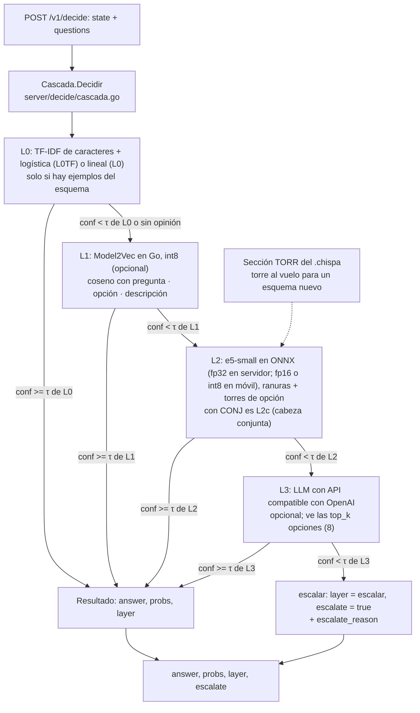
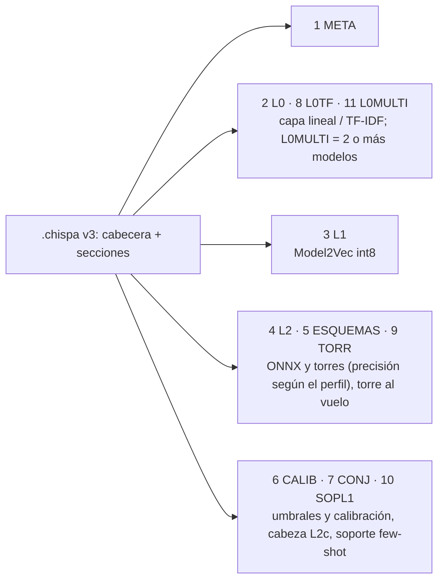
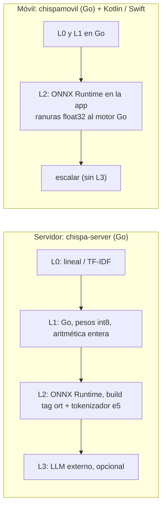

<p align="center">
  
</p>

<h1 align="center">Chispa</h1>

<p align="center">
  <strong>Clasificador tipado, barato y open source: un texto, una pregunta con opciones y una respuesta con su probabilidad.</strong><br>
  En CPU, sin GPU: en servidor, en ARM y en el móvil. Si no está seguro, no inventa: escala.
</p>

<p align="center">
  <a href="LICENSE"></a>
  
  
</p>

<p align="center">
  <a href="#inicio-rápido">Inicio rápido</a> ·
  <a href="#me-sirve">¿Me sirve?</a> ·
  <a href="#estado-real-con-cifras">Cifras</a> ·
  <a href="#cómo-decide-por-dentro">Por dentro</a> ·
  <a href="docs/00-indice.md">Documentación</a>
</p>

---

Chispa responde preguntas cerradas sobre un texto, en la línea de Jev o Laya. Mandas el texto y la pregunta con sus opciones, y
recibes la opción elegida, una probabilidad por opción y la capa que contestó. Las capas van de la más barata a la más cara (TF-IDF,
Model2Vec, e5-small y, si la activas, un LLM local) y cada una contesta solo si llega a su umbral τ. Si ninguna llega, devuelve
`"layer": "escalar"` con su mejor pista, para que decida una persona o un sistema más caro.

> [!NOTE]
> **Dónde está hoy.** Con ejemplos tuyos (≥ 20 por opción) clasifica bien y rápido: macro-F1 de 0,81–0,89 con p99 de unos 10 ms.
> Sin ejemplos (zero-shot) todavía escala casi todo. Las cifras, con su fichero de origen, están en [Estado real](#estado-real-con-cifras).

## ¿Me sirve?

| Sí, hoy | Todavía no |
|---|---|
| Enrutar mensajes con ejemplos propios: intenciones, buzones, tipo de PQRS | Decidir sin ejemplos con garantías (zero-shot) |
| Filtrar spam e inyecciones de prompt antes de llamar a un LLM | Razonar en varios pasos, comparar números o fechas |
| Ahorrar llamadas a un LLM: Chispa contesta lo fácil y escala lo dudoso | Puntuar en escala ordinal sin ejemplos (`score`) |
| Clasificar en el móvil o en el borde, sin red | Textos largos: L2 corta en 128 tokens y lo marca con `truncado` |

## Inicio rápido

Paso a paso completo en [`docs/02-inicio-rapido.md`](docs/02-inicio-rapido.md). Hace falta Python ≥ 3.9, Go y un potion exportado
(`potion.chispa-l1`, 155 MB, con [`runtime/l1/exportar.py`](runtime/l1/exportar.py)).

**1. Describe la pregunta** (`ferreteria.yaml`). En zero-shot, las descripciones son lo único que Chispa ve de tu tarea:

```yaml
id: solicitud
pregunta: ¿Qué necesita la persona que escribe a la ferretería?
tipo: choice
opciones:
  cotizacion: pide precio o disponibilidad de un producto, o una cotización de materiales
  pedido: quiere comprar y recibir productos, o pregunta por el estado de un pedido ya hecho
  garantia: reclama por una herramienta defectuosa, un cambio o una devolución
```

**2. Empaqueta el modelo.** Con `--ejemplos ejemplos.csv` entrena también L0 y calibra con tus datos:

```sh
PYTHONPATH=sdk/python python -m chispa train --esquema ferreteria.yaml --salida ferreteria.chispa --l1 potion.chispa-l1
```

**3. Sírvelo y pregunta:**

```sh
cd server && go build -o chispa-server ./cmd/chispa-server
./chispa-server -addr 127.0.0.1:8090 -modelo ../ferreteria.chispa
```

```sh
curl -s localhost:8090/v1/decide -d '{"state":"No me ha llegado el pedido y lo necesito hoy",
 "questions":[{"id":"u1","question":"¿Qué tan urgente es?","kind":"choice",
   "options":[{"id":"alta","description":"Requiere atención inmediata"},{"id":"baja","description":"Puede esperar"}]}]}'
```

```json
{"results": [
  {"id": "u1", "kind": "choice", "answer": "alta", "probs": {"alta": 0.9, "baja": 0.1},
   "layer": "L0", "escalate": false, "ms": 0}
]}
```

La forma es esta; los valores cambian con el modelo (ejemplo real en
[`choice.resp.json`](server/decide/testdata/choice.resp.json)). Contrato formal: [`server/api/openapi.yaml`](server/api/openapi.yaml).

## La API en una pantalla

`POST /v1/decide` (además de `/healthz` y `/metrics`). Valores de `kind` ([`server/decide/types.go`](server/decide/types.go)):

| `kind` | Qué pregunta es | Respuesta |
|---|---|---|
| `choice` | Elegir una opción (2 a 256) | el `id` elegido |
| `noul` | Sí o no | `"true"` o `"false"` |
| `score` | Nivel ordinal, ids `"1"` … `"K"` | `"1"` … `"K"` |
| `multi` | Varias opciones a la vez, o ninguna | `answers`: la lista de activas |

Cada resultado trae `answer`, `probs`, `layer`, `escalate` y `ms`. Además ([`docs/03-api.md`](docs/03-api.md)):

| Campo | Cuándo sale | Qué dice |
|---|---|---|
| `escalate_reason` | al escalar | `baja_confianza`, `sin_opinion`, `score_ids_no_validos`, `sin_presupuesto_torres` o `incompleta` |
| `calibrada` | cuando contesta una capa | `false`: la confianza de esa capa no está calibrada y el τ se aplicó sobre la cruda |
| `truncado`, `tokens_originales` | si alguna capa vio solo una parte del texto | que se cortó y cuántos tokens tenía entero |
| `unk_pct` | si se puede medir | fracción de tokens desconocidos (`<unk>`), en [0, 1] |

### SDK

| SDK | Léelo en |
|---|---|
| Python (`chispa train` y cliente) | [`sdk/python/README.md`](sdk/python/README.md) |
| JavaScript (Node ≥ 20 y navegador) | [`sdk/js/README.md`](sdk/js/README.md) |
| Go (cliente HTTP) | [`sdk/go/README.md`](sdk/go/README.md) |
| Android (Kotlin) | [`sdk/android/README.md`](sdk/android/README.md) |
| iOS (Swift, sin compilar) | [`sdk/ios/README.md`](sdk/ios/README.md) |
| Motor móvil en Go (`gomobile`) | [`sdk/movil/README.md`](sdk/movil/README.md) |

Ningún paquete está publicado en un registro: se usan desde el repositorio ([`sdk/README.md`](sdk/README.md)).

## Tres modos

| Modo | Qué necesitas | Estado |
|---|---|---|
| Zero-shot | El esquema, con buenas descripciones | Flojo: escala casi todo |
| Few-shot | Pocos ejemplos por opción | L1 sube de 0,45 a 0,65 de macro-F1 con 32 ejemplos por clase |
| **Con datos del cliente** (`chispa train --conjunta`: L0TF + L2c) | ≥ 20 ejemplos por opción | **El que funciona** |

## Estado real, con cifras

Cada cifra sale del fichero enlazado. Una sola corrida y una sola semilla salvo que se diga otra cosa. Lo que no se midió está en
[`docs/07`](docs/07-rendimiento-y-limites.md#qué-no-se-midió).

**Con datos del cliente.** Macro-F1 por `/v1/decide` con la cascada de producción
([`e2e-20261028/LEEME.md`](server/deploy/resultados/e2e-20261028/LEEME.md)): **0,814 en massive y 0,887 en clinc150**, con p99 de
9–12 ms por consulta (c6a.xlarge, 1 cliente). L0 contesta el 54–67 % de las consultas. Sin ejemplos propios estas cifras no valen.

**Zero-shot: no vende hoy.**
- L1 (potion): macro-F1 medio de 0,455 en 5 tareas; 0,406 en massive y 0,445 en clinc150
  ([`informe`](model/l1/resultados/2026-10-28/informe.md)).
- L2 solo, con τ elegido en validación: únicamente spam cumple «escalada ≤ 30 % con precisión ≥ 0,85» (0 % de escalada,
  precisión 0,926). clinc150 escala el 11 % con precisión 0,777; massive, hatecheck e inyecciones escalan entre el 78 % y el 100 %
  ([`LEEME`](model/bench/tau/resultados-20261103/LEEME.md)).
- JevBench (231 casos, 117 esquemas): L2 zero-shot saca 0,407, por debajo del suelo de 0,55 que se buscaba; 108 casos pasan de
  128 tokens ([`LEEME`](model/evaluacion/resultados/jevbench-20261029/LEEME.md)).
- Un codificador abierto ajustado de punta a punta (e5-small sin congelar con cabeza cross-encoder, destilado de un LLM local)
  saca 0,511 en JevBench frente a 0,4935 de Chispa en el mismo arnés, pero con p50 de 206 ms frente a los ≤ 60 ms pedidos: no
  compensa ([`informe`](model/alt/resultados/g5-2058ffa/informe.md)).

**L3 (LLM local), como respaldo.** Con Ollama y `qwen3:4b-instruct` en un i7 de 4 núcleos, sobre 1 061 filas: en hatecheck (sí/no)
la cascada pasa del 28,8 % al 48,5 % a unos 4 s por escalada; en massive (60 opciones) apenas cambia (43,6 → 44,0 %). Sus
probabilidades son autodeclaradas, no calibradas ([`LEEME`](model/bench/l3/resultados-20261103/LEEME.md)).

**Robustez.** ASR de 0,021 en injection y spam, en parte porque el detector escala el 47 % y el 83 % de los ataques
([`LEEME`](server/deploy/resultados/arena-20261028/LEEME.md)).

**Latencia en CPU para esquemas nuevos.** Servidor fp32 en un i7 de 4 núcleos, petición de 3 preguntas: p50 de 290 ms con la caché
de torres fría y de 58 ms caliente, unos 13 ms por torre e5 ([`LEEME`](model/bench/caida/resultados-20261102/LEEME.md)).

**Sin medir:** calidad de L2 con torre al vuelo en tareas no vistas, latencia en Android e iOS y tareas colombianas reales. Para estas
últimas está en marcha un banco de 450 PQRS públicas anonimizadas, etiquetadas a ciegas
([`GUIA_BANCO_PQRS.md`](model/etiquetado/GUIA_BANCO_PQRS.md)).

## Cómo decide por dentro

Todo lo de esta sección sale del código; cada nodo lleva su fichero.



Reglas de la cascada ([`server/decide/cascada.go`](server/decide/cascada.go), `Cascada.Decidir`):

- Se prueba cada capa en orden: L0, L1, L2, L3. La respuesta se acepta si `conf > 0` y `conf >= τ` de esa capa. Una capa sin modelo
  o con error cuenta como confianza 0. Un `.chispa` sin sección L1 se salta esa capa.
- **El τ lo manda la sección `CALIB`** del `.chispa`, se arranque o no con `-config`: L1 usa `tau_escalate`; L2, `tau_escalate_l2`
  (si falta, `tau_escalate`), y con `CONJ`, `tau_l2c`. La config solo puede subirlo, nunca bajarlo. Un `CALIB` sin τ se rechaza
  al cargar ([`docs/04`](docs/04-formato-chispa.md)). Sin `.chispa`, los τ por defecto son 0,80, 0,80, 0,70 y 0,60
  ([`config.go`](server/decide/config.go)).
- **L3 está apagada por defecto**: sin sección `l3` en la config no opina ([`l3.go`](server/decide/l3.go)). No existe en el motor
  móvil ni en Kotlin o Swift.

<details>
<summary><strong>Secciones del <code>.chispa</code> v3</strong></summary>

Enum `Tipo` en [`format/chispa3/chispa3.go`](format/chispa3/chispa3.go); detalle en [`docs/04`](docs/04-formato-chispa.md).



</details>

<details>
<summary><strong>Servidor y móvil</strong></summary>



- **L1**: pesos int8 con escala float32 por fila y aritmética entera, idéntica en amd64 y arm64 ([`runtime/l1/embed.go`](runtime/l1/embed.go)).
- **L2**: la precisión la elige el perfil de exportación (`--perfil servidor|movil|movil-int8`): fp32, fp16 con vocabulario podado o
  int8 dinámico ([`docs/02`](docs/02-inicio-rapido.md)). El servidor puede tomar la torre int8 de otro `.chispa` con `torre_fichero`.
- La cascada del móvil vive en Kotlin ([`Cascada.kt`](sdk/android/chispa/src/main/kotlin/com/chispa/sdk/Cascada.kt)) y Swift; el motor
  Go no lleva ONNX Runtime.

</details>

## De dónde viene

El nombre y el icono vienen de [kindling](https://github.com/juan52878911/kindling), la leña menuda con la que se enciende el fuego.
Chispa nació allí como `pkg/chispa`, un clasificador lineal diminuto para decisiones pequeñas, y esa pieza sigue siendo su capa L0:
`server/`, el formato `.chispa`, el motor móvil y el entrenador la importan como módulo de Go. kindling también pone la imagen para
desplegar Chispa en una microVM ([`deploy/kindling/`](deploy/kindling/README.md)).

## Mapa del repositorio

| Carpeta | Qué hay |
|---|---|
| [`docs/`](docs/00-indice.md) | Documentación de producto: [qué es](docs/01-que-es.md), [inicio rápido](docs/02-inicio-rapido.md), [API](docs/03-api.md), [formato](docs/04-formato-chispa.md), [límites](docs/07-rendimiento-y-limites.md) |
| [`server/`](server/README.md) | `chispa-server`: cascada y capas (`decide/`), torres (`torre/`), OpenAPI, carga y despliegue |
| [`format/chispa3/`](format/chispa3/README.md) | El formato `.chispa` v3 y su cargador en Go |
| `runtime/` | L1 (Model2Vec en Go, int8) y el tokenizador de e5 en Go |
| `model/` | Entrenamiento, L2, evaluación, líneas base, banco de PQRS e informes |
| [`sdk/`](sdk/README.md) | Python, JS, Go, Android, iOS y el motor móvil |
| [`arena/`](arena/README.md) | Banco de pruebas adversarial; `make test` y `make smoke` delegan aquí |
| [`pilotos/`](pilotos/README.md) | Kit de piloto para una empresa colombiana |
| [`demos/caida`](demos/caida/README.md), [`demo/wasm`](demo/wasm/README.md) | Demos |
| [`audio/`](audio/README.md) | Diseño de Chispa de audio, sin modelos |

Antes de dar algo por terminado: `make test` y `make smoke`.

## Licencia

Apache-2.0, código y pesos: [`LICENSE`](LICENSE); atribuciones de terceros en [`NOTICE`](NOTICE). Los datasets con SA, NC o términos
pendientes (XNLI, clima, datos.gov.co, SIB-200, etiquetas de ALIA, salidas de Haiku) no se redistribuyen y solo se usan como test.
